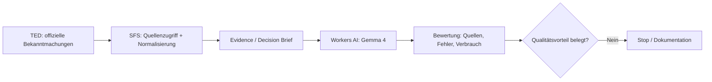

# SFS Tender Intelligence — A Product Hypothesis Tested

**Case study · EU public procurement · Cloudflare Workers · TED Search API · Workers AI · evidence-driven evaluation**

Im November 2026 habe ich im Rahmen von SFS-Labs eine Geschäftsidee zur KI-gestützten Analyse europäischer Ausschreibungen untersucht. Aus der ursprünglichen Idee entstand ein lauffähiger Prototyp: ein modularer JavaScript-Dienst auf Cloudflare Workers, angebunden an die offizielle TED Search API v3 und Cloudflare Workers AI (Gemma 4). Die technische Integration wurde mit echten Bekanntmachungen geprüft.

Entscheidend war allerdings nicht, ob die Technologie funktioniert, sondern ob sie gegenüber der direkten Arbeit mit denselben Quelldaten einen belegbaren Vorteil erzeugt. Dafür habe ich den Ansatz in mehreren Schritten konkretisiert, eine Änderungs- und Quellenlogik aufgebaut und schließlich einen vorab festgelegten A/B-Test durchführen lassen.

**Das Ergebnis war negativ:** Bei vier unabhängigen Modellaufrufen auf derselben vorbereiteten Evidenz lieferten Baseline und SFS jeweils alle 16 gesuchten Fakten korrekt. Mit den erwarteten Quellenkennungen belegte die Baseline 26 von 32 Antworten, die SFS-Variante 25 von 32. Ein Qualitätsvorteil war nicht nachweisbar.

Die Erweiterung zur vollständigen Dokumenten- und Änderungsintelligenz wäre fachlich, rechtlich und operativ deutlich komplexer geworden. Für eine eigenständig weitergeführte Produktentwicklung fehlte mir eine hinreichend starke wirtschaftliche These. Deshalb habe ich die kommerzielle Weiterentwicklung vorerst eingestellt und den Prozess als überprüfbare Fallstudie dokumentiert.

## Was tatsächlich umgesetzt wurde

| Baustein | Erreichter Stand |
|---|---|
| EU-TED-Suche | Offizielle TED Search API v3, kanonische Metadaten, nachvollziehbare Quellen-URLs |
| Backend | Modulare JavaScript-Module, Cloudflare Workers, API-Endpunkte, Authentisierung und Grenzen |
| Modellanalyse | Tatsächlich ausgeführte Workers-AI-Inferenz mit Gemma 4 |
| Evidenz | Trennung von Quellendaten, Modellinterpretation und ungeprüften Voraussetzungen |
| Change Intelligence | Historische Bekanntmachungsversionen, Friständerungen, Dokumentenabgleich als privater Forschungsprototyp |
| Gegenprüfung | Vier echte A/B-Modellläufe; negativer Befund dokumentiert |
| Entscheidungsfolge | Weiterentwicklung nicht fortgeführt, weil Nutzen und Aufwand nicht überzeugend zusammenliefen |

**Technische Entwicklung:** KI-gestützt und iterativ; mein Beitrag liegt in Ausgangsthese, Zielvorgaben, Priorisierung, Prüfkriterien, Gegenhypothesen und der Entscheidung über Fortführung oder Abbruch. Die Fallstudie behauptet nicht, dass jedes Code-Detail von Hand geschrieben oder unabhängig fachgutachterlich geprüft wurde.

## Architektur und Entscheidungsweg

Die kontrollierte Vorschau lief technisch, die Payment-Schnittstellen blieben deaktiviert. Die Live-Infrastruktur und die nicht freigegebenen Vergabeanlagen gehören nicht zu dieser Veröffentlichung.

## Wichtigster Test: Same Evidence, Different Processing

Bei einem eingefrorenen Forschungsfall aus dem polnischen Vergabewesen erhielten beide Modellvarianten **denselben Satz zuvor extrahierter Fakten**. Nur der SFS-Arm bekam zusätzliche, deterministisch abgeleitete Hinweise zu Änderungen und Risiken. Modell, Fragen und Ausgabeformat waren identisch. Die Reihenfolge der vier Läufe war A–B–B–A.

| Kennzahl | Baseline A | SFS B |
|---|---:|---:|
| Modellaufrufe | 2 | 2 |
| Sachlich richtige Werte | 32/32 | 32/32 |
| Richtige Werte **mit erwarteter Quellenkennung** | **26/32** | **25/32** |
| Ø Laufzeit des Modellaufrufs | 15,57 s | 13,11 s |
| Ø Workers-AI-Verbrauch | 41,25 Neurons | 37,96 Neurons |
| Ø Eingabetokens | 2.726 | 3.108 |

Die beiden Arme nutzten bereits **vorverarbeitete** Quellenfakten. Dieser Versuch beweist deshalb **nicht**, wie sich ein vollständiger Roh-PDF-zu-Entscheidung-Prozess gegen eine konventionelle Verarbeitung schlägt. Mit zwei Läufen je Arm ist auch der Laufzeitunterschied nicht statistisch belastbar. Die verwendeten Originalantworten und weitergehenden Einkaufsunterlagen verbleiben im privaten Forschungsbestand. Die hier veröffentlichten Aggregatdaten lassen sich offline nachrechnen.

**Nachvollziehbar nachrechnen:** `npm test` oder `npm run verify` (Node.js 20+; keine Cloud-Kosten).

## Dossiers

- [Studienaufbau und Grenzen](docs/METHODOLOGY.md)
- [Technische Entscheidungen und Stop-Entscheidung](docs/DECISION-LOG.md)
- [Quellen, Rechte und Publikationsgrenzen](docs/SOURCES-AND-RIGHTS.md)
- [Anonymisierte A/B-Messwerte](data/ab-aggregate.json)
- [Wiederholbare numerische Prüfung](scripts/verify.mjs)

## Primärquellen

Die in der Studie verwendeten öffentlichen TED-Bekanntmachungen bleiben bei der EU abrufbar, z. B. [773817-2026](https://ted.europa.eu/en/notice/-/detail/773817-2026), [773821-2026](https://ted.europa.eu/en/notice/-/detail/773821-2026) und die im Änderungsvergleich verwendete Bekanntmachung [771954-2026](https://ted.europa.eu/en/notice/-/detail/771954-2026).

Die EU erlaubt die Weiterverwendung ihrer TED-Bekanntmachungen grundsätzlich, weist aber auf mögliche Rechte Dritter hin: [TED Legal Notice](https://ted.europa.eu/en/legal-notice). Originale polnische Vergabeanlagen und daraus übernommene längere Passagen werden **nicht** in diesem öffentlichen Repository verteilt.

## Veröffentlichung und Nutzungsrechte

Dieses GitHub-Repository dokumentiert die technische und wirtschaftliche Untersuchung. Die öffentliche Lesbarkeit ist **nicht** automatisch eine Open-Source-Lizenz. Für Code und redaktionelle Inhalte ist derzeit keine allgemeine Nachnutzungslizenz erteilt. TED-Daten und fremde Inhalte unterliegen unabhängig davon den jeweils einschlägigen Bedingungen. Siehe [Quellen- und Rechteprüfung](docs/SOURCES-AND-RIGHTS.md).

*Letzter fachlicher Stand: 9. November 2026.*
